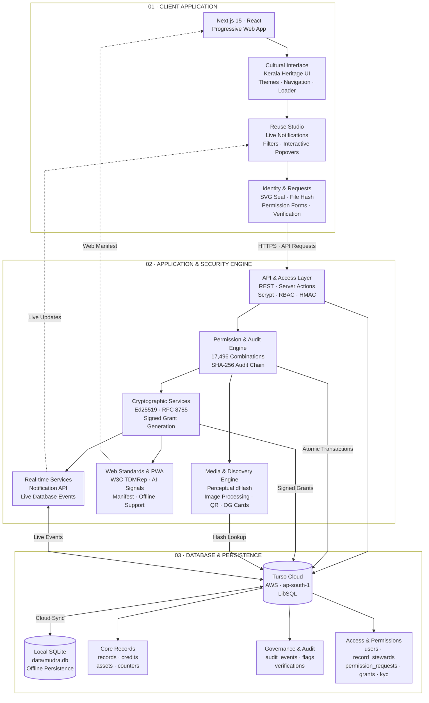

# Project Title: Mudra — Cultural Passports Living Heritage Registry

> **Event:** ART//CODE 2026 · **Problem Statement:** PS-03 "Credit the Culture"  
> **Team:** Abhin Krishna M P & Alin Alex · **License:** MIT Open Source  
> **Live Production:** [mudra-one-ivory.vercel.app](https://mudra-one-ivory.vercel.app)  

[](tests/)
[](scripts/contrast.mjs)
[](public/manifest.json)
[](https://nextjs.org)
[](https://turso.tech)

---

## 1. Project Overview

**Mudra** turns *"ask first"* into a recorded, verifiable answer, and publishes it in a form that both people and machines can read.

In digital archives, stock photo libraries, and artificial intelligence training datasets, indigenous traditions and sacred artforms are routinely extracted from their geographic and cultural origins. While legal copyright licences (such as Creative Commons CC BY or CC0) grant legal permission to copy or remix digital imagery, they fail to convey living community wishes regarding sacred ritual depictions, commercial exploitation, or generative AI model training.

Mudra solves this by issuing **Cultural Passports** for traditional works:
1. **Dual-Layer Evaluation:** Concurrently evaluates what tradition bearers have stated alongside the file's legal copyright licence, synthesizing a conservative plain-language verdict.
2. **Actionable Ask → Grant Workflow:** Reusers submit a structured 4-field reuse request. Verified cultural stewards review requests in their console and issue cryptographically signed grants (Ed25519 over RFC 8785 canonical JSON) that platforms and print shops can verify online or offline.
3. **Machine-Readable Layer for Platforms:** Publishes W3C TDMRep AI-training reservation signals (`/.well-known/tdmrep.json`), schema.org `CreativeWork` JSON-LD, signed dataset manifests, and privacy-preserving hash-only lookup APIs.
4. **Living Cultural Experience (v2.0):** Features a master **Traditional Kerala Padippura** entrance gateway navbar, full **Progressive Web App (PWA)** offline capabilities, a **Live Registry Notification Center**, dual-theme **3D Heritage Stages**, and **Zero-Heat GPU Performance Engineering**.
5. **Decentralized Author & Steward Governance:** Implements role-based author boundaries, automated tag-based steward routing (`region` + `category`), steward KYC identity verification with private cloud storage, edge-level AI Shield header injection, and an asynchronous revision feedback loop.

### The Core 3-Act Loop

$$\mathbf{Check} \quad\longrightarrow\quad \mathbf{Ask} \quad\longrightarrow\quad \mathbf{On\ Record}$$

1. **Check:** A creator or platform checks an image via drag-and-drop perceptual dHash matching (`/check`) or explores the catalogue (`/catalogue`). Mudra displays the dual-layer Cultural Passport, detailing both community permissions and the legal file licence.
2. **Ask:** When a verdict requires asking first (e.g., commercial merchandise or AI training), reusers submit a 4-field structured request (name, private contact, project scope, duration). Reusers receive a private tracking link (`/request/[token]`) with live status updates.
3. **On Record:** Named cultural stewards review the request, apply custom conditions and validity windows, and issue an Ed25519 digitally signed grant. Anyone can verify the grant online (`/g/[grantId]`) or completely offline using the standalone CLI verifier (`node scripts/verify-grant.mjs`).

*Mudra is not an automated copyright filter and does not dispense legal claims. It records community consensus so creators can ask before they build.*

---

## 2. Problem Statement

> **ART//CODE 2026 — Problem Statement PS-03: "Credit the Culture"**

### The Core Challenges:
1. **Severed Attribution:** Digital archives and image scrapers strip traditional artforms of their geographical origins, artisan lineages, and living custodians.
2. **Copyright Conflated with Cultural Consent:** Open licences (like CC BY or CC0) govern digital file copyright, but fail to reflect living community boundaries regarding sacred rituals, sacred regalia, or commercial mass production.
3. **"Ask First" Was a Dead End:** Registries traditionally stop at telling users to "Ask first". Reusers are left with no standardized protocol to ask, stewards have no structured channel to respond, and platforms have no cryptographic receipt to verify.
4. **Generative AI Exploitation:** AI crawlers harvest traditional motifs indiscriminately without community consent, attribution, or compensation.

---

## 3. Key Features

### 3.1 Two-Layer Mathematical Permission Engine
- Evaluates $6\text{ reuse scenarios} \times 6\text{ licence regimes} \times 3^4\text{ community states} \times 2\text{ attribution options} \times 3\text{ sensitivities} = 17,496$ combinations via pure mathematical resolution.
- Enforces the core invariant: **Any "no" wins, then any "ask", else permitted.** Proved exhaustively with automated property tests (`tests/permissions.test.ts`).

### 3.2 Actionable Ask → Grant Consent Workflow
- **Structured 4-Field Request Form:** Requester submits scope, medium, duration, and private contact info (honeypot-protected and rate-limited).
- **Privacy by Default:** Requester contact details are kept strictly private—never leaked to public audit diffs, JSON APIs, or signed grant certificates.
- **Ed25519 Canonical Grant Artifact:** Digital signature over RFC 8785 canonical JSON referencing the record's current audit head hash.
- **Offline CLI Verification:** Verifiable offline with `node scripts/verify-grant.mjs grant.json public-key.pem`.

### 3.3 Active AI Shield (W3C TDMRep Protocol)
- **Global Manifest (`/.well-known/tdmrep.json`):** Static machine-readable manifest legally reserving text and data mining rights under W3C standard and EU DSM Directive Art. 4.
- **Edge Header Injection:** Edge Middleware intercepts all incoming requests to the image asset directory (`/uploads/`) and attaches `tdm-reservation: 1` HTTP response headers to prevent AI training extraction.
- **Hash-Only Platform Lookup API (`POST /api/v1/lookup`):** Platforms check batches of up to 50 SHA-256 and perceptual dHash digests without uploading user imagery.
- **Signed Dataset Manifest (`GET /api/v1/manifest.json`):** Cryptographically signed snapshot of all registered cultural works, hashes, and AI stances.

### 3.4 Perceptual Image Matching via dHash
- 64-bit gradient difference hashing (dHash) to match visually similar images regardless of recompression, scaling, or cropping.
- Calibrated thresholds on real Kerala cultural seed photographs: Hamming distance $\le 6 \implies$ "Strong match"; $\le 12 \implies$ "Possible match, for human review"; $\ge 28 \implies$ "No similarity".

### 3.5 Traditional Kerala Padippura Master Navbar
- Handcrafted Kerala entrance gateway (*Padippura*) featuring a pitched terracotta tile roof, brass *kettuvallam* boat, hanging *nilavilakku* lamp, and golden *gopuram* pediment across dual 2087×436 master artworks (`navbar-full.png` and `navbar-dark.png`).
- Re-composited subpixel vector-sharp typography in ivory cream (`#fff8ee`) and Kerala temple gold (`#f2ce73`), eliminating blur on high-DPI Retina screens.
- Pixel-perfect CSS percentage hotspot mapping with active gold diamond end-caps and mobile slide-down drawer.

### 3.6 Progressive Web App (PWA) & Offline Engine
- Installable standalone Progressive Web App across Android, iOS, Windows, macOS, and Linux.
- Service Worker (`public/sw.js`) implementing **cache-first** for heavy WebP artworks, static assets, and OFL webfonts; **network-first with offline cache fallback** for dynamic passport routes.

### 3.7 Live Registry Notification System
- Connected to database aggregator (`/api/notifications`) streaming real-time audit events (`approved`, `verified`, `granted`, `created`) to an interactive navbar popover with unread badge pulses.

### 3.8 Zero-Heat GPU Performance Engineering
- Pre-rendered $64\times 64$ offscreen sprite for particle animations, dropping radial gradient creations from **3,278 in 3s down to 1** (**99.97% reduction**).
- Tab background sleep lifecycle (`visibilitychange`) completely sleeps animation loops when tab is hidden (**0% CPU / 0% GPU in background**).
- String caching for CSS variables and hardware layer promotion (`transform: translateZ(0)`).

### 3.9 Secure Author Submissions & Role-Based Access Control
- Public registration (`/login?mode=signup`) defaults new accounts to `author` with declared region and domain category.
- Submissions are restricted to verified authors; `/submit` is guarded by Edge Middleware and re-verified on execution by `createRecordAction`.

### 3.10 Specific Steward Routing via Tag Matching
- Inbound drafts require declared **Region** and **Category**.
- Steward dashboard (`/review`) strictly filters pending drafts matching the steward's assigned expertise jurisdiction:
  $$\text{stewards only see drafts where: } \text{status} = \text{'pending'} \land \text{region} = \text{steward.region} \land \text{category} = \text{steward.category}$$

### 3.11 Steward KYC Verification & Reviewer Console Approvals
- Authors upload identity documents at `/apply-steward` stored in secure private storage (Supabase, Vercel Blob, serverless `/tmp`).
- Reviewers and stewards inspect pending applications directly on `/review` via the **Steward Verification Requests** section (`StewardApplicationsSection.tsx`) with a centered overview metrics box.
- Authorized users view private documents via `/api/admin/kyc-document/[id]`, and can approve or reject applicants with instant database role elevation and tag jurisdiction assignment (`region` + `category`).
- System administrators retain full governance visibility on the administrative route (`/admin`).

### 3.12 Asynchronous Revision Feedback Loop
- Stewards request specific edits via structured revision notes (`needs_revision`).
- Authors receive clear alerts on `/author/dashboard` displaying feedback notes.
- One-click "Edit & Resubmit" reopens the pre-filled form (`/submit?edit=[id]`), rectifies details, and resets status to `pending`.

### 3.13 Serverless Artwork Submission Resilience
- **10MB Server Action Body Limit:** Next.js 15 App Router enforces a default 1MB request body limit on server actions. High-resolution mobile camera and DSLR photos routinely range from 2MB to 8MB. Configured `experimental: { serverActions: { bodySizeLimit: '10mb' } }` in `next.config.mjs` to eliminate HTTP 413 / 500 body-parser rejections.
- **Serverless Storage Fallback:** On cloud serverless environments (e.g. Vercel read-only Lambda `/var/task` filesystems) where external Blob tokens may not be configured, `storeUpload` and `readLocalAsset` in `src/lib/storage.ts` gracefully fall back to base64 `data:` URIs and `/tmp` storage, ensuring uploads never fail with `EROFS` or `ENOENT`.
- **Top-Level Error Isolation:** Wrapped `createRecordAction` in structured `try...catch` handling with `isRedirectError` detection, ensuring intentional redirects succeed while unforeseen issues surface clean inline validation messages rather than crashing into `error.tsx`.

---

## 4. Technology Stack

<div align="center">

### Framework & Runtime


### Database & Storage


### Cryptography & Security


### Imaging & Digital Assets


### Web Standards


### Styling & Typography


### Testing & Quality Assurance


### Deployment & Infrastructure


</div>

---

## 5. System Architecture



---

## 6. Installation & Setup Instructions

Clone and run Mudra locally with zero external services required:

```bash
# 1. Clone the repository
git clone https://github.com/Abhin-Krishna-MP/Mudra.git
cd Mudra

# 2. Install dependencies (Node.js 22.5+ required)
npm install

# 3. Configure local environment
cp .env.example .env

# 4. Seed the database with 15 verified Kerala cultural heritage records
npm run seed

# 5. Start the Next.js development server
npm run dev
```

Open [http://localhost:3000](http://localhost:3000) in your browser.

### Test Harness & Verification Commands

```bash
# Run unit & cryptographic test suite (43 tests passing)
npm test

# Run TypeScript strict type-checking
npm run typecheck

# Verify WCAG AA contrast compliance
npm run contrast

# Verify licence compliance and source floor
npm run check-licences

# Offline standalone grant verification
node scripts/verify-grant.mjs path/to/grant.json path/to/public-key.pem
```

---

## 7. Environment Variables

Create a `.env` file in the project root. For local development, **no keys are required**—Mudra operates completely offline using local SQLite (`data/mudra.db`) and in-memory key generation.

| Variable Name | Required | Default / Description |
|:---|:---:|:---|
| `DATABASE_URL` | Optional | `file:data/mudra.db` for local SQLite. For production, supply Turso LibSQL URL (`libsql://...turso.io`). |
| `DATABASE_AUTH_TOKEN` | Optional | Auth token for remote Turso database (leave blank for local SQLite). |
| `SESSION_SECRET` | Optional | Any 32-byte hex string used for signing authentication cookies (`openssl rand -hex 32`). A default dev key is used if unset. |
| `NEXT_PUBLIC_SITE_URL` | Optional | Public base URL (`https://mudra-one-ivory.vercel.app` or `http://localhost:3000`), used in credit lines and QR codes. |
| `BLOB_READ_WRITE_TOKEN` | Optional | Vercel Blob token for cloud uploads. If left empty, local uploads go to `public/uploads` with a resilient data-URI serverless fallback. |
| `SIGNING_PRIVATE_KEY` | Optional | Ed25519 PKCS8 PEM private key for signing audit events and grants. If unset, an in-memory fallback key is generated automatically. |
| `SIGNING_KEY_ID` | Optional | Key identifier string (defaults to `k1`). |
| `SUPABASE_URL` | Optional | Optional private KYC storage bucket URL. |
| `SUPABASE_SERVICE_ROLE_KEY` | Optional | Optional private KYC storage service role secret. |

---

## 8. Usage Instructions

### 8.1 For Reusers, Creators & Platforms
1. **Explore the Catalogue:** Visit `/catalogue` or `/check` to discover cultural records, filter by region and artform category, or match an image with drag-and-drop dHash matching.
2. **Review the Cultural Passport:** Click into any passport (`/r/[id]`) to view uncropped artwork, accredited tradition bearers, historical context, and the dual-layer permission card.
3. **Interactive Reuse Studio:** Navigate to `/reuse` to test intended use cases (sharing, commercial print, remixing, AI training) and copy ready-made attribution formats (Plain Text, Academic, BibTeX, HTML).
4. **Submit a Permission Request:** When a use requires asking first, click **Request Permission**, complete the 4 structured fields, and track status at your private tracking link (`/request/[token]`).

### 8.2 For Tradition Bearers & Authors
1. **Sign Up:** Create an author account at `/login?mode=signup` with your geographic region and cultural craft domain.
2. **Submit a Cultural Work:** Access `/submit` to upload an artwork, declare tradition bearers, cite authentic references, and state community reuse positions.
3. **Manage Revisions:** Open `/author/dashboard` to view submission status (`pending`, `needs_revision`, `published`). If revisions are requested, click **Edit & Resubmit** to rectify details.
4. **Apply as Steward:** Submit institutional or identity documentation at `/apply-steward` to apply for steward elevation.

### 8.3 For Cultural Stewards & Reviewers
1. **Sign In:** Log in at `/review`.
2. **Specific Steward Routing:** Stewards review incoming submissions pre-filtered strictly by their assigned region and category.
3. **Approve or Request Revisions:** Reviewers verify sources and approve works into the public catalogue, or request asynchronous revisions with specific notes.
4. **Steward Verification Requests:** Review and approve incoming steward KYC applications right inside the console.
5. **Issue Verifiable Grants:** Review incoming commercial or AI requests and issue cryptographically signed Ed25519 Grant certificates.

### 8.4 Evaluation Credentials

| Role | Email | Password | Access Route & Permissions |
|:---|:---|:---|:---|
| **Cultural Reviewer** | `reviewer@mudra.demo` | `DemoReviewerPass123!` | `/review` — General queue, flag resolution, KYC verification, and publication. |
| **Cultural Steward** | `steward@mudra.demo` | `DemoStewardPass123!` | `/review` — Tag-filtered steward queue (`region` + `category`), revision requests, and signed grants. |
| **System Admin** | `admin@mudra.internal` | `DemoAdminPass123!` | `/admin` — System-wide governance and administrative oversight. |
| **Cultural Author** | Any registered author | *Set at signup* | `/submit` & `/author/dashboard` — Sign up at `/login?mode=signup`, submit works, review feedback, and apply for steward status. |

---

## 9. Demonstration Screenshots

| Screen | Theme | Description |
| :--- | :---: | :--- |
|  | **Light** | **Home & Kathakali Backwaters Stage:** Daylit Kerala backwaters sunset, animated Kathakali eye tracking, floating Kasavu silk cloth, and warm nilavilakku lamp glow. |
|  | **Dark** | **Home & 3D Theyyam Stage:** Night temple courtyard, 3D Panchuruli Theyyam figure, hardware-accelerated cursor torchlight, rising embers, and Padippura master navbar with subpixel razor-sharp typography. |
|  | **Light** | **Cultural Passport (`/r/[id]`):** Warm archival museum parchment aesthetic, uncropped artwork mat, deterministic SVG mandala seal, and dynamic QR credit card. |
|  | **Dark** | **Live Registry Notifications Popover:** Interactive notification bell displaying real-time database updates for new publications, reviewer verifications, and steward grants with unread count badges. |
|  | **Light** | **Interactive Reuse Studio (`/reuse`):** Dual-layer mathematical permission engine, live plain-language verdict cards, and 4 one-click copyable attribution formats. |
|  | **Dark** | **Verify Page & Tamper Simulation (`/verify/[id]`):** Cryptographic SHA-256 audit chain timeline, client-side browser file hashing, and interactive in-memory tamper simulator. |
|  | **Light** | **Reviewer & Steward Governance Console (`/review`):** Role-guarded dashboard for reviewing inbound permission requests, verifying steward KYC applicants, and issuing Ed25519 digitally signed grants. |
|  | **Dark** | **Check An Image (`/check`):** Calibrated 64-bit gradient difference hashing (dHash) to match resized, recompressed, and cropped imagery for human review. |
|  | **Light** | **Mobile Viewport & PWA:** Installable standalone Progressive Web App with warm sunlight palette, mobile Padippura bar, touch navigation, and zero CTA overlap. |

---

## 10. Team Members

- **Abhin Krishna M P** — Backend Architecture, Cryptographic Grants (Ed25519/RFC 8785), LibSQL / Turso Database, Machine Layer & W3C TDMRep, GPU Performance Engineering, Deployment & Security.
- **Alin Alex** — Design System, Traditional Kerala Padippura UI/UX, Editorial Museum Aesthetics, Accessible Client Flows, Seed Curation & Documentation.

---

## 11. Limitations & Future Scope

### Honest Technical Limitations
- **Not a Legal Court or Automatic Filter:** Mudra records community consensus; it is not an automated copyright takedown filter and does not dispense legal advice.
- **Tamper-Evident, Not Tamper-Proof:** Sequential SHA-256 audit chains reveal if an entry was edited or deleted, but historical credibility relies on initial human verification of source citations.
- **Voluntary Machine Protocol:** W3C TDMRep signals (`/.well-known/tdmrep.json` and `tdm-reservation: 1`) are machine-readable declarations legally reserving rights under EU DSM Directive Art. 4, but bad-faith scrapers can choose to ignore standard HTTP headers.
- **Perceptual Match Scope:** 64-bit gradient dHash identifies cropped, resized, or recompressed instances of the same photograph; it does not identify novel artistic derivative paintings of the same underlying motif.

### Future Scope & Roadmap
1. **Decentralized Identifiers (DIDs) & Verifiable Credentials:** Transition steward signatures to W3C Verifiable Credentials and decentralized tribal registries.
2. **Oral Heritage & Audio Transcripts:** Extend passports beyond visual and performing arts to audio recordings of oral Malayalam folk songs (*Vadakkan Pattukal*, *Mappila Paattu*).
3. **Design Software Integrations:** Plugins for Figma, Adobe Creative Cloud, and Canva to warn designers in real time when importing protected cultural motifs.
4. **Smart Contract Trust Anchors:** Optional periodic anchoring of audit chain heads onto zero-carbon public ledgers for external third-party time-stamping.

---

## 12. License & Attribution

- **Software License:** MIT Open Source (see [`LICENSE`](LICENSE)).
- **Zero Hallucinated Culture:** AI tools were used strictly for coding and scaffolding. Every cultural fact, tradition bearer credit, geographical origin, and license attribution was researched, cited, and checked by human team members from primary academic and governmental sources:
  - *UNESCO Intangible Cultural Heritage Lists*
  - *Kerala Kalamandalam Deemed University for Art and Culture*
  - *Kerala Folklore Academy*
  - *Geographical Indications Registry of India*
  - *Archaeological Survey of India (ASI)*
- **Prohibited Words Invariant:** Enforced via automated test `tests/wording.test.ts`. Extractive buzzwords (`owner`, `ownership`, `proof of ownership`, `stolen`, `detected`, `infringement`, `authentic`) are prohibited throughout the platform to respect living cultural heritage.
