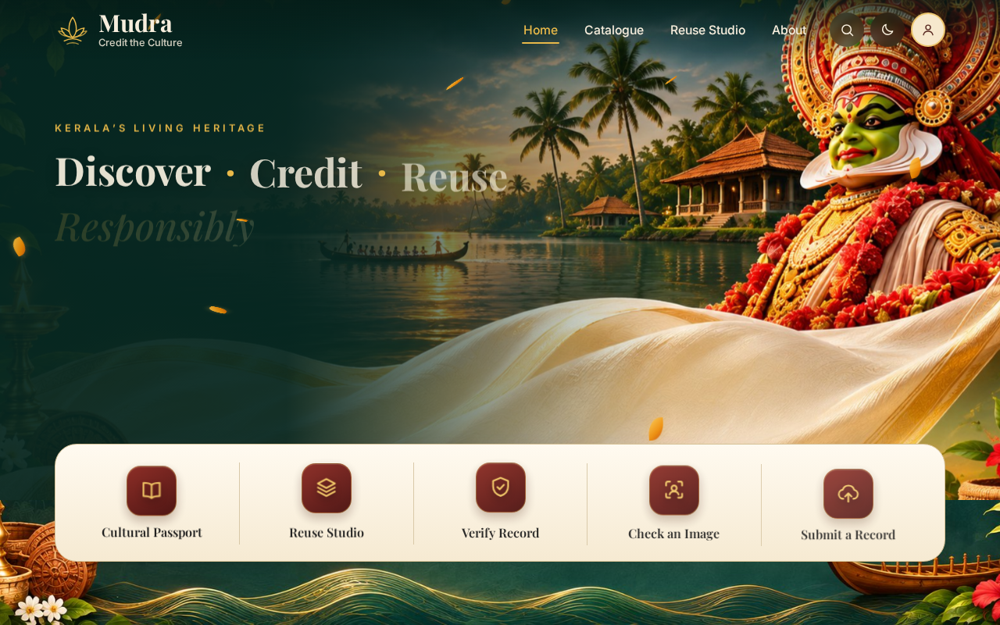
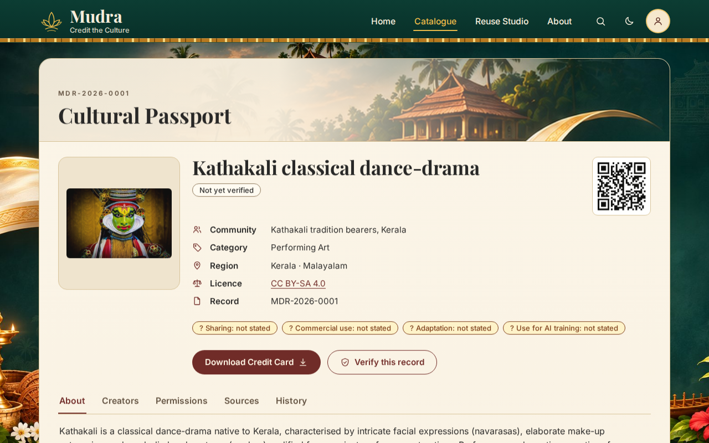
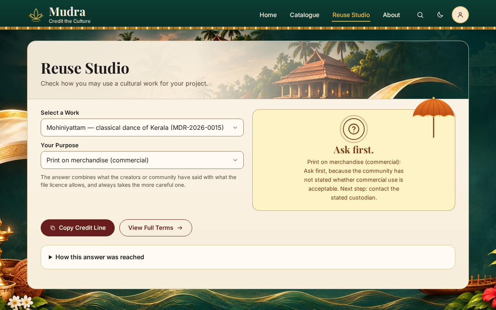
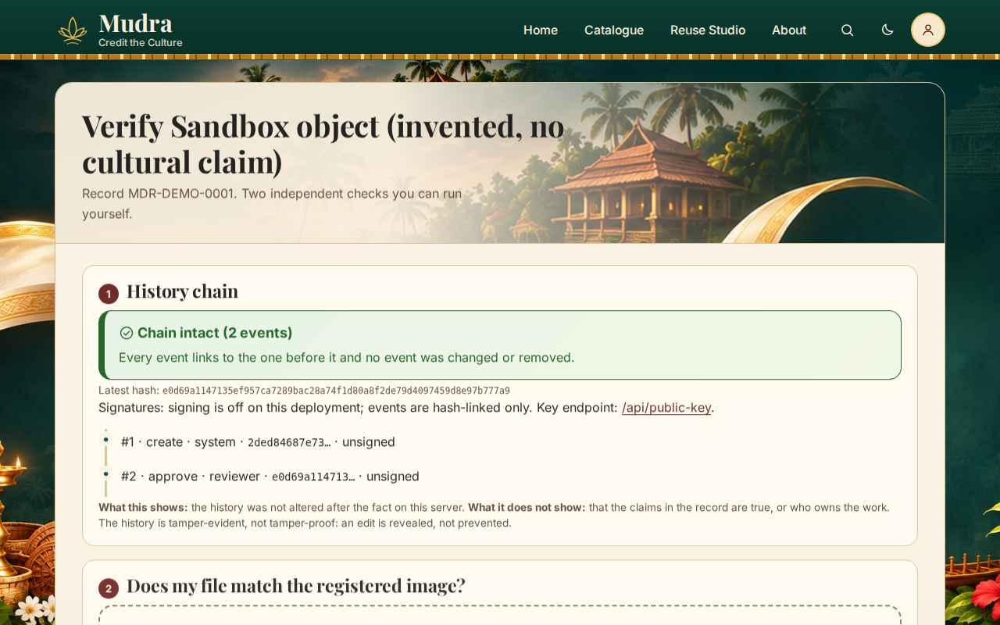
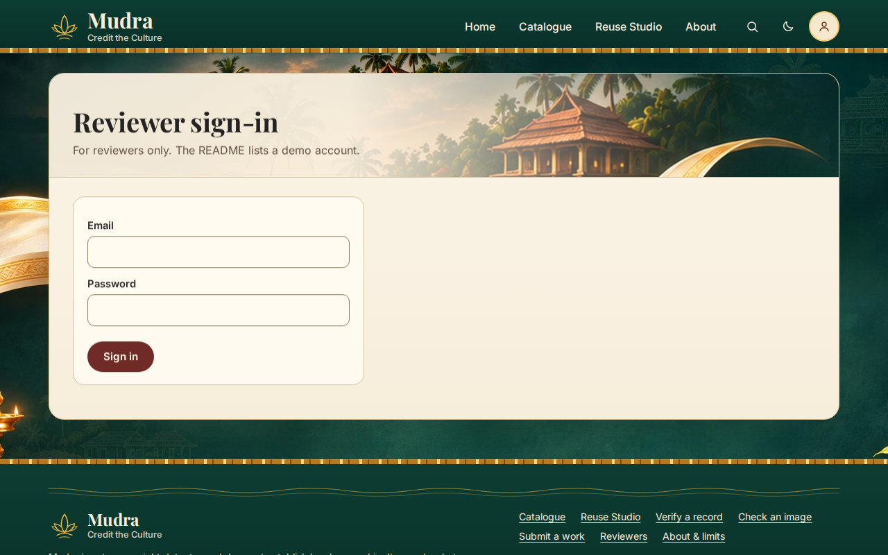
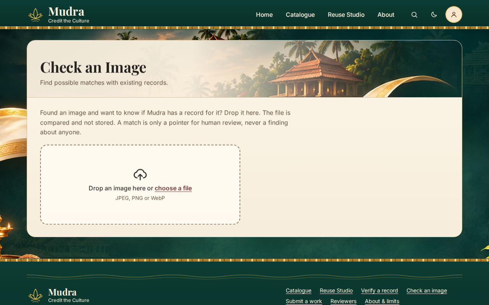

# Mudra — Cultural Passports

> ART//CODE 2026 · PS-03 **Credit the Culture** · Team: Abhin + Alin · MIT

## 1. Project Overview
Mudra turns **"ask first"** into a recorded, verifiable answer, and publishes it in a form people and machines can both read.

Every cultural work has a public **Cultural Passport**: who it comes from, where the information comes from, and what the creators/community **and** the file licence say you may do with it. The **Reuse Studio** evaluates both layers into one plain answer. When a use requires asking first, reusers can submit a structured permission request; named cultural stewards grant requests with conditions and sign cryptographic grants (Ed25519 over canonical JSON) that platforms and print services can verify online or offline. For platforms and AI builders, Mudra provides W3C TDMRep signals, schema.org JSON-LD, signed manifests, and a privacy-preserving hash-only lookup API.

Mudra is not a copyright detector and does not establish legal ownership. It records what is stated so people can ask before they reuse. Not related to any financial scheme.

## 2. Problem Statement
PS-03: people reuse cultural imagery without knowing who it comes from or what its creators and licence allow. Credit gets lost, communities are not asked, and licence terms are mixed up with cultural wishes.

## 3. The Core Path: Check → Ask → On Record

1. **Check:** A designer or creator drops an image into `/check` or explores `/catalogue`. Mudra checks exact byte hashes and calibrated perceptual dHash visual similarity, displaying the dual-layer Cultural Passport and explaining why a permission verdict is "Ask first".
2. **Ask:** Reusers click *Request permission* directly in the Reuse Studio, entering project scope and private contact details. Requests are sent directly to the linked community steward (or transparently forwarded if no steward is yet linked). Reusers receive a private status tracking link (`/request/[token]`).
3. **On Record:** Stewards review requests in their console and issue signed permission grants (RFC 8785 canonical JSON + Ed25519) with explicit validity windows, required credit lines, and conditions. Anyone can verify the grant at `/g/[grantId]` or verify offline with `node scripts/verify-grant.mjs`.

## 4. Key Features

- **Cultural Passports & Dual-Layer Permissions:** Sourced cultural records with separate creator/community permissions and file licences evaluated conservatively (17,496 property test combinations passing).
- **Ask → Grant Workflow:** 4-field structured request, steward console review, and offline-verifiable signed grants.
- **Machine-Readable Layer for Platforms:** schema.org `CreativeWork` JSON-LD, W3C TDMRep AI-training opt-out reservation signals (`/.well-known/tdmrep.json`), and `tdm-reservation` HTTP headers.
- **Hash-Only Platform API & Signed Manifest:** `POST /api/v1/lookup` for platforms (no image uploads required) and `GET /api/v1/manifest.json` with signed dataset snapshots.
- **Tamper-Evident SHA-256 Audit Chain:** Canonical JSON history with sequential hashing and Ed25519 signing.
- **Calibrated Perceptual Image Matching:** dHash image matching calibrated on real seed photos (survives resizing and recompression; distinct subjects score $\ge 28$).
- **Deterministic Identity Seal:** SVG seal deterministically derived from SHA-256 of record ID and credits.
- **Dynamic 1200×630 Credit Cards:** OpenGraph credit cards generated with uncropped artwork, credit lines, and QR codes.

## 5. Technology Stack
Next.js (App Router) + TypeScript · SQLite locally / Turso (libSQL) live · `sharp` · `next/og` + `qrcode` · Node `crypto` (SHA-256, Ed25519) + `canonicalize` · plain CSS · `node:test` + Playwright · Vercel + Turso + Vercel Blob.

## 5. System Architecture
```
Browser ── Next.js pages (server components)
              │  server actions: create / flag / review (role-guarded)
              ▼
         src/lib/repo.ts ──► DB (libSQL: records, credits, assets, flags, users, audit_events)
              │                  every change + its audit event commit in ONE transaction
              ├─ permissions.ts  pure two-layer engine
              ├─ chain.ts        SHA-256 hash chain (+ optional Ed25519 signatures)
              ├─ credit.ts       credit-line builders (HTML-escaped)
              └─ imagehash.ts    SHA-256 + dHash (sharp)
```

## 6. Installation & Setup
```bash
git clone https://github.com/Abhin-Krishna-MP/Mudra.git && cd Mudra
cp .env.example .env
npm install
npm run seed          # loads data/seed/records.json (+ demo reviewer if DEMO_REVIEWER_PASSWORD is set)
npm run dev           # http://localhost:3000
```
No keys are needed locally. Node 22.5+ required. `npm test` runs the logic tests; `npm run predeploy` = check-secrets + check-licences + test.

## 7. Environment Variables
| Name | Purpose | Required |
| --- | --- | --- |
| `DATABASE_URL` | `file:./data/mudra.db` locally, `libsql://…` on Turso | yes |
| `DATABASE_AUTH_TOKEN` | Turso token | live only |
| `SESSION_SECRET` | signs reviewer session cookies (long random string) | live (required in production) |
| `NEXT_PUBLIC_SITE_URL` | base URL in credit lines and QR codes | yes |
| `BLOB_READ_WRITE_TOKEN` | Vercel Blob for uploads (else `public/uploads` locally) | live |
| `SIGNING_PRIVATE_KEY`, `SIGNING_KEY_ID` | Ed25519 audit signing (`npm run gen-key`); empty = unsigned | optional |
| `DEMO_REVIEWER_PASSWORD` | used by `npm run seed` to create `reviewer@mudra.demo` | demo only |

## 8. Usage
Reviewer demo login: `reviewer@mudra.demo` / `DemoReviewerPass123!` (demo throwaway account for evaluation). Create real reviewers with:
```bash
ADMIN_PASSWORD=... npm run create-admin -- you@example.org "Your Name" reviewer
```
Flows: search → open a passport → pick a use in the Reuse Studio → request permission if needed → steward reviews and issues signed grant → verify grant at `/g/<grantId>`.

### Offline Grant Verification
Permission grants can be verified completely offline with zero network connectivity:
```bash
node scripts/verify-grant.mjs path/to/grant.json path/to/public-key.pem
```

## 9. Demonstration Screenshots

| Screen | Description |
| --- | --- |
|  | **Home & Catalogue**: Featured carousel, 3D lotus ornament, live search, and filters. |
|  | **Cultural Passport (`/r/[id]`)**: Uncropped artwork mat, deterministic seal, QR code, and tabs. |
|  | **Reuse Studio (`/reuse`)**: Interactive dual-layer permission evaluator and one-click credit lines. |
|  | **Verify Page (`/verify/[id]`)**: Real-time SHA-256 hash check, audit timeline, and live tamper simulation. |
|  | **Reviewer Console (`/review`)**: Pending review queue, report resolutions, and evidence notes. |
|  | **Check an Image (`/check`)**: Visual similarity lookup for human review using dHash and exact matching. |

## 10. Team Members
- **Abhin** — schema, permission engine, audit chain, auth, actions, image pipeline, deploy.
- **Alin** — design system, catalogue, passport, Reuse Studio, reviewer/timeline/verify UI, accessibility, slides and video.

## 11. Limitations & Future Scope
See the in-app About page. In short: permissions are stated snapshots, not legal advice; the history is tamper-evident, not tamper-proof; image matching misses heavy edits; the licence table was checked against CC legal texts; rate limiting is best-effort. Future: community corrections workflow, private status links, Malayalam labels, and museum curation partnerships.

## 12. License & Attribution
Code: MIT (see `LICENSE`). Every seed image's source and licence is listed in `data/seed/sources.md`. **AI-tooling disclosure:** AI coding tools were used to write code. No cultural facts, sources, permissions or licences were written by AI; those come from cited sources written and checked by the team. Correspondence: Organizers at `delta@cce.edu.in` confirmed AI coding assistants are permitted for implementation.
