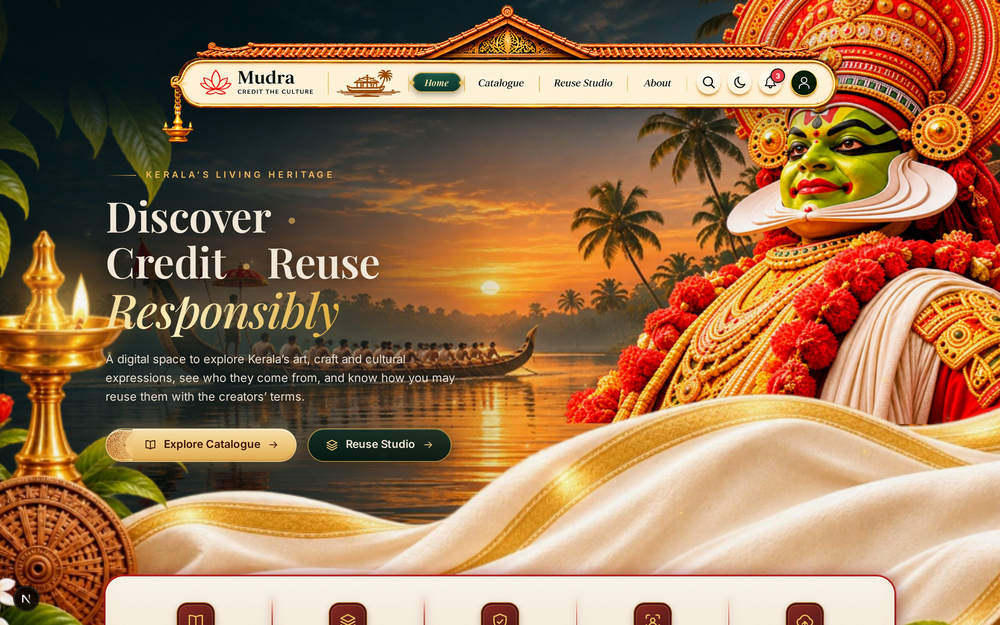
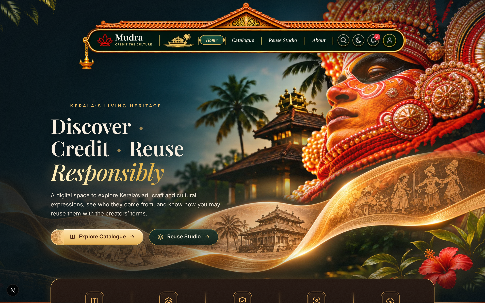
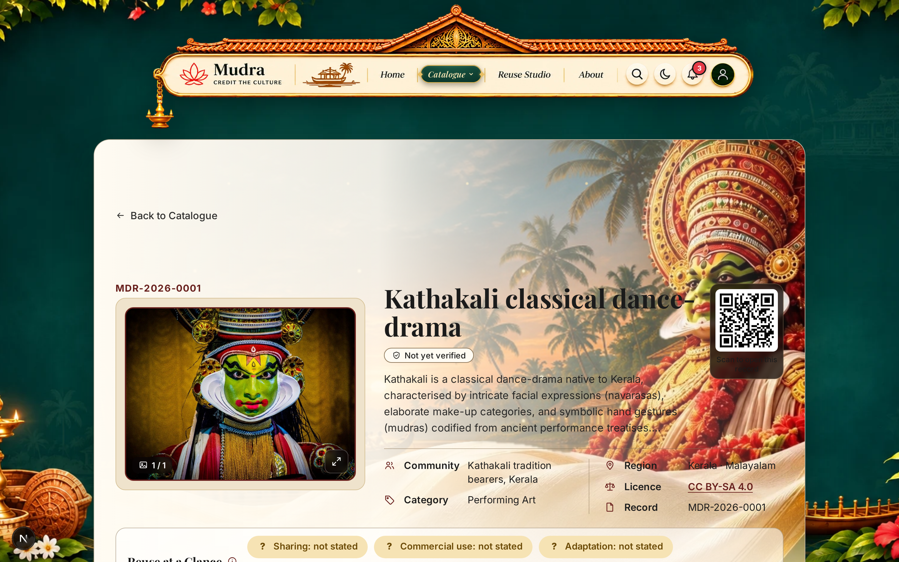
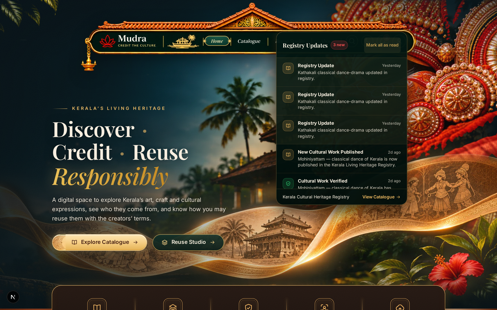
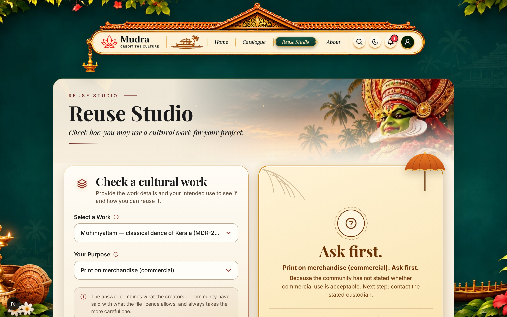
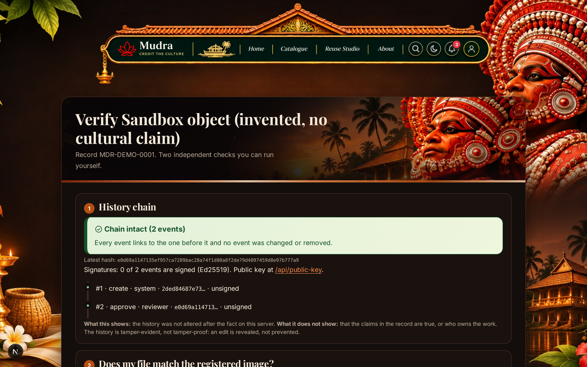
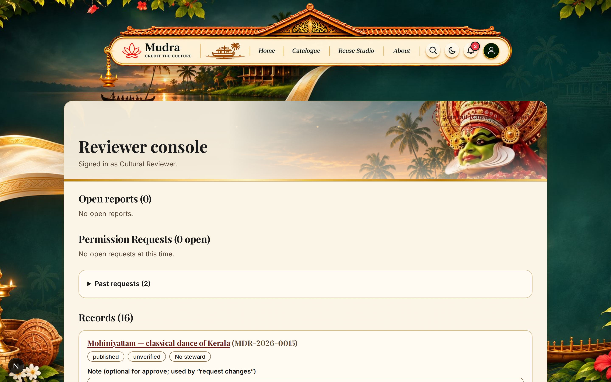
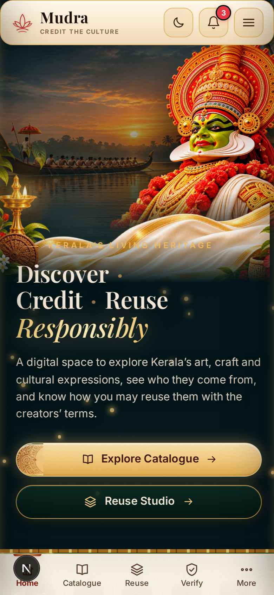

# Mudra — Cultural Passports: Living Heritage Registry

> **Event:** ART//CODE 2026 · **Problem Statement:** PS-03 "Credit the Culture"  
> **Team:** Abhin Krishna M P & Alin Alex · **License:** MIT Open Source  
> **Live Production:** [mudra-one-ivory.vercel.app](https://mudra-one-ivory.vercel.app)  

[](tests/)
[](scripts/contrast.mjs)
[](public/manifest.json)
[](https://nextjs.org)
[](https://turso.tech)

---

## 1. Project Overview

**Mudra** turns *"ask first"* into a recorded, verifiable answer, and publishes it in a form that both people and machines can read.

In digital archives, stock libraries, and AI training datasets, indigenous traditions and sacred artforms are routinely extracted from their geographic and cultural origins. Legal copyright licenses (such as Creative Commons CC BY or CC0) grant legal permission to copy or remix an image, but they fail to convey living community wishes regarding sacred ritual depictions, commercial exploitation, or generative AI training. Reusers are left at a dead end when registries say "Ask first": there is no standardized protocol to ask, no structured channel for community stewards to answer, and no cryptographic receipt for platforms to verify.

Mudra solves this by issuing **Cultural Passports** for traditional works:
1. **Dual-Layer Evaluation:** Evaluates what the tradition bearers and community have stated alongside the digital file's copyright licence, synthesizing a conservative plain-language verdict.
2. **Actionable Ask → Grant Workflow:** Reusers submit a structured 4-field request. Verified cultural stewards review requests in their console and issue cryptographically signed grants (Ed25519 over RFC 8785 canonical JSON) that platforms and print shops can verify online or offline.
3. **Machine-Readable Layer for Platforms:** Publishes W3C TDMRep AI-training reservation signals (`/.well-known/tdmrep.json`), schema.org `CreativeWork` JSON-LD, signed dataset manifests, and privacy-preserving hash-only lookup APIs.
4. **Living Cultural Experience (v2.0):** Features a master **Traditional Kerala Padippura** navbar, full **Progressive Web App (PWA)** offline capabilities, a **Live Registry Notification Center**, dual-theme **3D Heritage Stages**, and **Zero-Heat GPU Performance Engineering**.
5. **Decentralized Author & Steward Governance:** Implements role-based author boundaries, automated tag-based steward routing (`region` + `category`), steward KYC identity verification with private cloud storage, edge-level AI Shield header injection, and asynchronous revision feedback.

*Mudra is not an automated copyright filter and does not dispense legal claims. It records community consensus so reusers can ask before they build.*

---

## 2. The Core 3-Act Loop

$$\mathbf{Check} \quad\longrightarrow\quad \mathbf{Ask} \quad\longrightarrow\quad \mathbf{On\ Record}$$

1. **Check:** A creator or platform checks an image via drag-and-drop perceptual dHash matching (`/check`) or explores the catalog (`/catalogue`). Mudra displays the dual-layer Cultural Passport, detailing both the community's cultural permissions and the legal file licence.
2. **Ask:** When a verdict requires asking first (e.g., commercial merchandise or AI training), reusers submit a 4-field structured request (name, private contact, project scope, duration). Reusers receive a private tracking link (`/request/[token]`) with live status updates.
3. **On Record:** Named cultural stewards review the request, apply custom conditions and validity windows, and issue an Ed25519 digitally signed grant. Anyone can verify the grant online (`/g/[grantId]`) or completely offline using the standalone CLI verifier (`node scripts/verify-grant.mjs`).

---

## 3. Fresh Demonstration Gallery (Alternating Light & Dark Themes)

| Screen | Theme | Description |
| :--- | :---: | :--- |
|  | **Light** | **Home & Kathakali Backwaters Stage:** Daylit Kerala backwaters sunset, animated Kathakali eye tracking, floating Kasavu silk cloth, and warm nilavilakku lamp glow. |
|  | **Dark** | **Home & 3D Theyyam Stage:** Night temple courtyard, 3D Panchuruli Theyyam figure, hardware-accelerated cursor torchlight, rising embers, and Padippura master navbar with subpixel razor-sharp typography. |
|  | **Light** | **Cultural Passport (`/r/[id]`):** Warm archival museum parchment aesthetic, uncropped artwork mat, deterministic SVG mandala seal, and dynamic QR credit card. |
|  | **Dark** | **Live Registry Notifications Popover:** Interactive notification bell displaying real-time database updates for new publications, reviewer verifications, and steward grants with unread count badges. |
|  | **Light** | **Interactive Reuse Studio (`/reuse`):** Dual-layer mathematical permission engine, live plain-language verdict cards, and 4 one-click copyable attribution formats. |
|  | **Dark** | **Verify Page & Tamper Simulation (`/verify/[id]`):** Cryptographic SHA-256 audit chain timeline, client-side browser file hashing, and interactive in-memory tamper simulator. |
|  | **Light** | **Reviewer & Steward Governance Console (`/review`):** Role-guarded dashboard for reviewing inbound permission requests, setting custom conditions, and issuing Ed25519 digitally signed grants. |
|  | **Dark** | **Check An Image (`/check`):** Calibrated 64-bit gradient difference hashing (dHash) to match resized, recompressed, and cropped imagery for human review. |
|  | **Light** | **Mobile Viewport & PWA:** Installable standalone Progressive Web App with warm sunlight palette, mobile Padippura bar, touch navigation, and zero CTA overlap. |

---

## 4. Key Architectural Capabilities

### 4.1 Traditional Kerala Padippura Master Navbar
- **Cultural Architecture Motif:** Modeled after Kerala's heritage entrance gateway (*Padippura*): pitched terracotta tile roof, ornamental brass pediment (*gopuram*), backwater *kettuvallam* boat, and brass *nilavilakku* lamp.
- **Dual-Theme 2087×436 Master Artworks:** Dedicated light (`navbar-full.png`) and dark (`navbar-dark.png`) canvases.
- **Subpixel Typography Synthesis:** Inpainted blurry raster areas from 1024px uploads and re-composited subpixel vector-sharp typography in ivory cream (`#fff8ee`) and Kerala temple gold (`#f2ce73`), eliminating blur on 2× Retina screens.
- **Precision Percentage Hotspots:** Pixel-perfect CSS coordinates for brand, navigation pills (with live active pill indicators and gold diamond end-caps), search, theme switch, notification bell, and user avatar.

### 4.2 Progressive Web App (PWA) & Offline Engine
- **Web App Manifest (`src/app/manifest.ts` & `public/manifest.json`):** Configured for full standalone execution with synchronized theme colors (`#0c3d33` light, `#0a0607` dark) and an adaptive icon suite (`16px` to `512px`, maskable).
- **Service Worker (`public/sw.js`):** **Cache-first** strategy for heavy WebP artworks, static assets, and OFL webfonts; **network-first with offline cache fallback** for dynamic passport routes.
- **Heritage In-App Install Banner:** Custom install prompt capturing `beforeinstallprompt` with dismissal persistence.

### 4.3 Live Registry Notification System
- **Real-Time Database Feed (`/api/notifications`):** Aggregates recent audit events (`approved`, `verified`, `granted`, `created`) from `audit_events`, `grants`, and `records` tables.
- **Interactive Notification Popover:** Connected to the navbar bell button with an unread badge counter, filtering tabs ("All", "Approvals", "Grants"), and mark-as-read persistence.

### 4.4 Zero-Heat GPU Performance Engineering
- **Offscreen Sprite Pre-rendering:** Replaced dynamic re-allocation of 70 `CanvasGradient` objects per frame with a single $64\times 64$ offscreen sprite blitted via hardware-accelerated `drawImage`. Gradient creations dropped from **3,278 in 3s down to 1** (**99.97% reduction**).
- **Tab Background Sleep Lifecycle:** Animation frame loops in `HeroMotion` and `HeroKerala` automatically sleep when the tab is hidden or minimized (`visibilitychange`), dropping background power draw to **0% CPU / 0% GPU**.
- **DOM Mutation Deduping:** Cached string outputs for CSS variables to prevent redundant style recalcs and mask re-evaluations during idle states.
- **Hardware Layer Promotion:** Added `transform: translateZ(0)` to blurred layers and ember canvases to eliminate continuous CPU Gaussian blur re-rasterization.

### 4.5 Two-Layer Permission Engine
- Evaluates $6\text{ reuse scenarios} \times 6\text{ licence regimes} \times 3^4\text{ community states} \times 2\text{ attribution options} \times 3\text{ sensitivities} = 17,496$ combinations via pure mathematical resolution. Proven with comprehensive property tests (`tests/permissions.test.ts`).

### 4.6 Cryptographic Audit Chain & Offline Verifiable Grants
- **SHA-256 Append-Only Chain:** Sequential hash linking where payload $P_k$ is canonicalized via RFC 8785 (`canonicalize`) and hashed with $H_{k-1}$.
- **Ed25519 Asymmetric Signatures:** Audit heads and grant certificates are digitally signed.
- **Offline CLI Verifier:** Independent CLI verification script (`scripts/verify-grant.mjs`) requiring zero network or database dependencies.

### 4.7 Machine Layer & AI Transparency
- **W3C TDMRep AI Signals:** Dynamic `/.well-known/tdmrep.json` and `tdm-reservation: 1` HTTP headers for records where AI training is not permitted.
- **schema.org `CreativeWork`:** JSON-LD metadata embedded in every passport page.
- **Privacy-Preserving Hash Lookup:** `POST /api/v1/lookup` checks cultural registration and AI stances in batches up to 50 items without image uploads.
- **Signed Manifest:** `GET /api/v1/manifest.json` provides an Ed25519-signed snapshot of all registered works.

### 4.8 Secure Author Submissions & Role-Based Access Control
- **Dedicated Author Boundary:** Open registration (`/login?mode=signup`) defaults new user roles to `author` with required expertise fields (region and cultural domain).
- **Two-Tier Route Protection:** Any attempt to access `/submit` is intercepted by Edge Middleware (`src/middleware.ts`) and verified against the signed HMAC session. Unauthorized or non-author requests are immediately redirected with an `Unauthorized` notification. Server actions (`createRecordAction`) re-verify the role against the database to prevent privilege escalation.

### 4.9 Specific Steward Routing via Tag Matching
- **Cultural Domain & Region Matching:** Draft submissions require both a **Region** (e.g. `Kannur`, `Thrissur`, `Palakkad`) and **Category** (e.g. `ritual`, `performing`, `handloom`, `craft`).
- **Targeted Dashboard Queues:** When cultural stewards log in to their console (`/review`), the database queries pending drafts filtered strictly by their assigned region and category:
  $$\text{stewards only see drafts where: } \text{status} = \text{'pending'} \land \text{region} = \text{steward.region} \land \text{category} = \text{steward.category}$$

### 4.10 Steward KYC Verification & Admin Review
- **Identity Document Upload (`/apply-steward`):** Authors can submit government or institutional identity documents to apply for steward elevation.
- **Secure Private Cloud Storage:** Documents are never placed in public web directories. Stored using private Supabase buckets, `@vercel/blob`, or private disk with serverless `/tmp` fallbacks.
- **Hidden Admin Governance Console (`/admin`):** Admins review pending KYC applications, stream documents via authenticated role-checked endpoints (`/api/admin/kyc-document/[id]`), and approve applicants, atomically promoting them to `steward` in the registry database.

### 4.11 Active AI Shield (W3C TDMRep Protocol)
- **Global Manifest:** Static declaration at `/.well-known/tdmrep.json` asserting platform-wide machine-readable text and data mining reservations under the W3C standard and EU DSM Directive Art. 4.
- **Edge Header Injection:** Edge Middleware intercepts all incoming requests to the image asset directory (`/uploads/`) and attaches `tdm-reservation: 1` HTTP headers to prevent web scrapers and AI model training pipelines from extracting imagery.

### 4.12 Asynchronous Revision Feedback Loop (Replacing Chat)
- **Non-Blocking Review:** Stewards click "Request Revision" on pending drafts, entering specific required corrections saved directly to `records.revision_note`, transitioning the status to `needs_revision`.
- **Author Dashboard Alerts (`/author/dashboard`):** Authors receive clear notifications of flagged drafts with full steward revision notes.
- **One-Click Resubmission:** An "Edit & Resubmit" action reopens the pre-filled submission form (`/submit?edit=[id]`), allowing authors to rectify details and resubmit, which atomically resets status to `pending`.

---

## 5. Technology Stack

<div align="center">

### Framework & Runtime


### Database & Storage


### Cryptography & Security


### Imaging & Digital Assets


### Web Standards


### Styling & Typography


### Testing & Quality Assurance


### Deployment & Infrastructure


</div>

---


## 6. System Architecture


---

<div align="center">

**Mudra — Preserving Heritage. Protecting Rights. Empowering Creators.**

</div>

---

## 7. Installation & Quickstart

Clone and run Mudra locally with zero external dependencies:

```bash
# 1. Clone repository
git clone https://github.com/Abhin-Krishna-MP/Mudra.git && cd Mudra

# 2. Configure environment
cp .env.example .env

# 3. Install dependencies (Node 22.5+ required)
npm install

# 4. Seed database with 15 verified cultural heritage records
npm run seed

# 5. Start development server
npm run dev

# Open http://localhost:3000 in your browser
```

### Evaluation Credentials

| Role | Email | Password | Dashboard & Access |
|:---|:---|:---|:---|
| **Cultural Reviewer** | `reviewer@mudra.demo` | `DemoReviewerPass123!` | `/review` — General review queue, flag resolution, and verification. |
| **Cultural Steward** | `steward@mudra.demo` | `DemoStewardPass123!` | `/review` — Tag-filtered steward queue (`region` + `category`), revision requests, and signed grants. |
| **System Admin** | `admin@mudra.internal` | `DemoAdminPass123!` | `/admin` — Steward KYC verification, identity document inspection, and steward elevation. |
| **Cultural Author** | Any registered author | *Set at signup* | `/submit` & `/author/dashboard` — Sign up at `/login?mode=signup`, submit works, review revision notes, and apply for steward status (`/apply-steward`). |

### Offline Standalone Grant Verification

Verify any permission grant artifact offline with zero network connectivity:

```bash
node scripts/verify-grant.mjs path/to/grant.json path/to/public-key.pem
```

---

## 8. Verification & Test Suite

Run the full automated test and compliance harness:

```bash
# 1. Unit & Cryptographic Test Suite (43 tests passing)
npm test

# 2. TypeScript Strict Validation (0 errors)
npm run typecheck

# 3. WCAG AA Contrast Compliance (10/10 passing)
npm run contrast

# 4. Playwright End-to-End User Journeys (Search -> Passport -> Reuse Studio -> Credit Line)
npm run test:e2e
```

---

## 9. Ethical Guardrails & Attribution

- **No Hallucinated Culture:** AI tools were utilized strictly for programming and scaffolding. Every cultural fact, tradition bearer credit, geographical origin, and license attribution was researched, cited, and checked by human team members from primary academic and governmental sources (UNESCO, Kerala Kalamandalam, Kerala Folklore Academy, and the Geographical Indications Registry of India).

- **Prohibited Words Invariant:** Enforced via `tests/wording.test.ts`. The extractive legalistic words `owner`, `ownership`, `proof of ownership`, `stolen`, `detected`, `infringement`, and `authentic` are forbidden throughout the codebase.

- **License:** MIT Open Source (see [`LICENSE`](LICENSE)).

---

## 10. Governance & Author Submission Protocol

Only signed-in users with the `author` role can submit drafts.

- `users.role` defaults to `author`; the public sign-up form (`/login?mode=signup`) creates authors with their assigned region and cultural domain.
- `/submit` is guarded twice: `src/middleware.ts` verifies the signed HMAC session and responds with a 307 redirect to `/login?msg=Unauthorized`; the page and `createRecordAction` then re-read the role from the database (`src/lib/authz.ts`), ensuring immediate role revocation.
- Reviewers and admins use `/review` and `/admin` respectively.
- KYC identity applications on `/apply-steward` use private cloud/serverless storage and can be inspected only by authenticated admins on `/admin`.
- Tag matching ensures that pending cultural drafts are routed exclusively to stewards with verified expertise in that craft's region and domain.
- When revisions are requested, draft statuses transition to `needs_revision` with feedback notes, and authors can one-click edit and resubmit back to `pending`.
