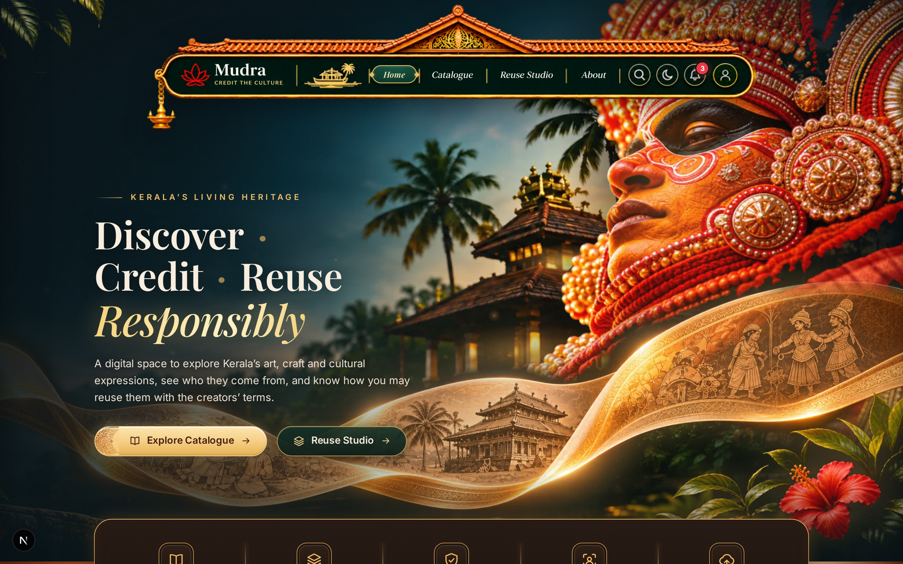
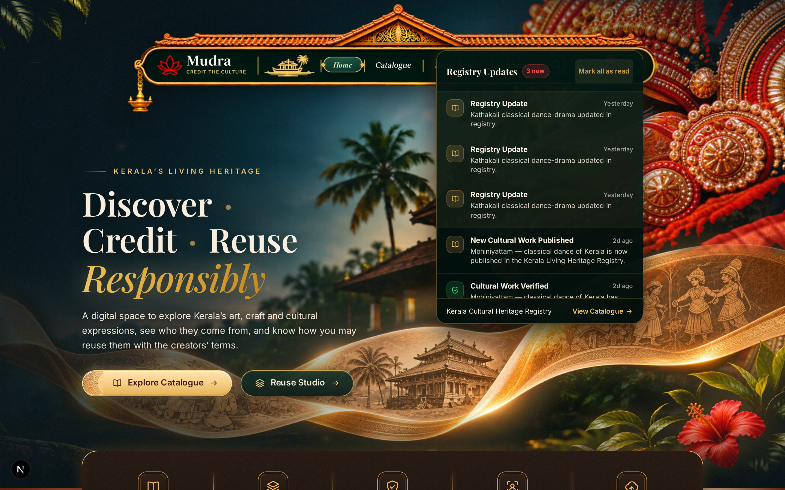
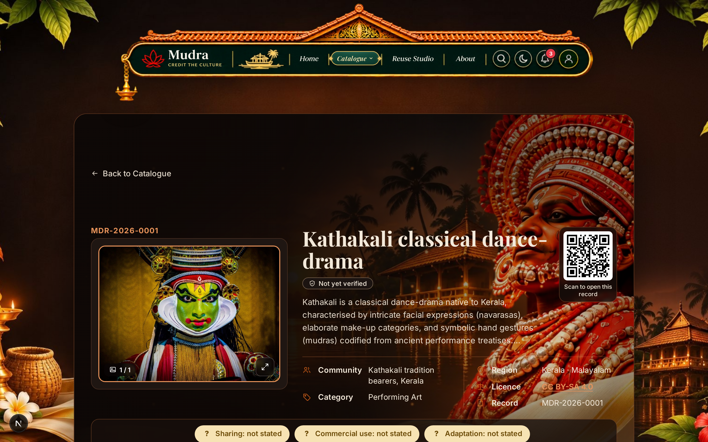
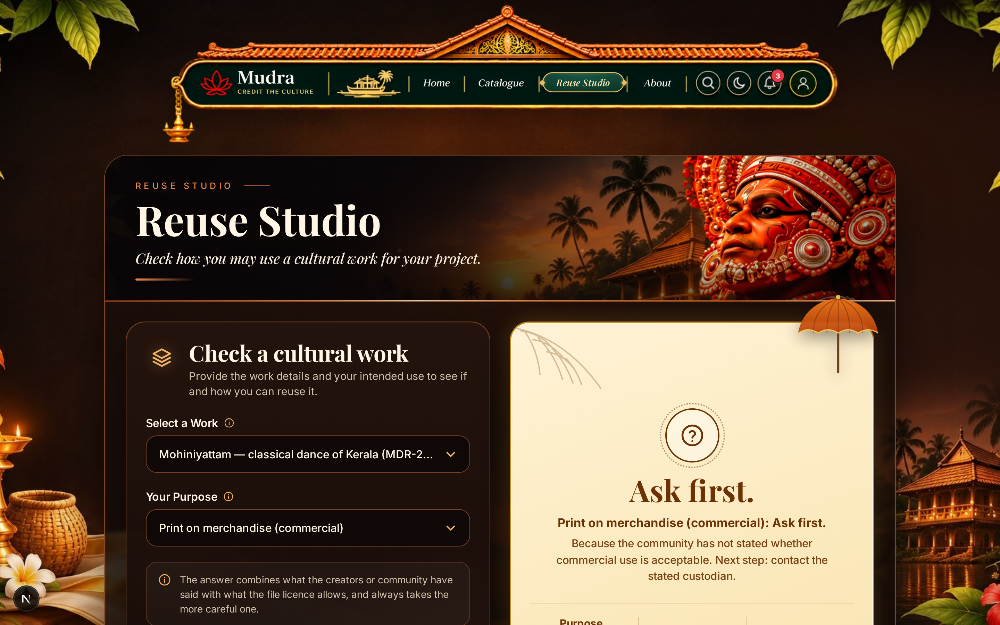
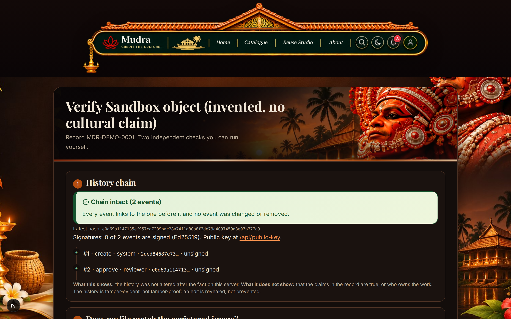
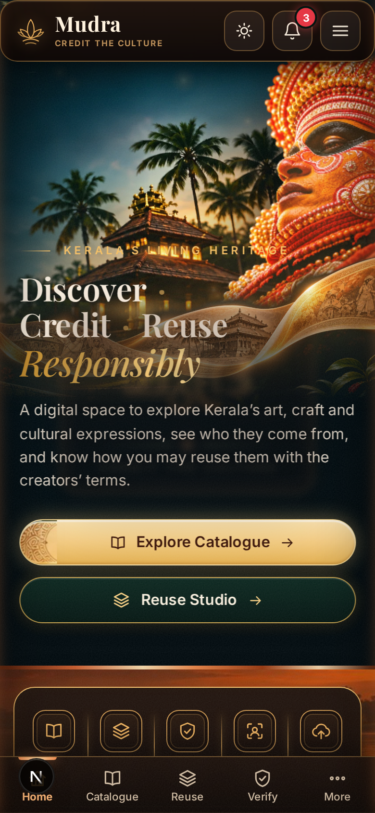

# Mudra — Cultural Passports: Living Heritage Registry

> **Event:** ART//CODE 2026 · **Problem Statement:** PS-03 "Credit the Culture"  
> **Team:** Abhin Krishna M P & Alin · **License:** MIT Open Source  
> **Live Production:** [mudra-one-ivory.vercel.app](https://mudra-one-ivory.vercel.app)  

[](tests/)
[](scripts/contrast.mjs)
[](public/manifest.json)
[](https://nextjs.org)
[](https://turso.tech)

---

## 1. Project Overview

**Mudra** turns *"ask first"* into a recorded, verifiable answer, and publishes it in a form that both people and machines can read.

In digital archives, stock libraries, and AI training datasets, indigenous traditions and sacred artforms are routinely extracted from their geographic and cultural origins. Legal copyright licenses (such as Creative Commons CC BY or CC0) grant legal permission to copy or remix an image, but they fail to convey living community wishes regarding sacred ritual depictions, commercial exploitation, or generative AI training. Reusers are left at a dead end when registries say "Ask first": there is no standardized protocol to ask, no structured channel for community stewards to answer, and no cryptographic receipt for platforms to verify.

Mudra solves this by issuing **Cultural Passports** for traditional works:
1. **Dual-Layer Evaluation:** Evaluates what the tradition bearers and community have stated alongside the digital file's copyright licence, synthesizing a conservative plain-language verdict.
2. **Actionable Ask → Grant Workflow:** Reusers submit a structured 4-field request. Verified cultural stewards review requests in their console and issue cryptographically signed grants (Ed25519 over RFC 8785 canonical JSON) that platforms and print shops can verify online or offline.
3. **Machine-Readable Layer for Platforms:** Publishes W3C TDMRep AI-training reservation signals (`/.well-known/tdmrep.json`), schema.org `CreativeWork` JSON-LD, signed dataset manifests, and privacy-preserving hash-only lookup APIs.
4. **Living Cultural Experience (v2.0):** Features a master **Traditional Kerala Padippura** navbar, full **Progressive Web App (PWA)** offline capabilities, a **Live Registry Notification Center**, dual-theme **3D Heritage Stages**, and **Zero-Heat GPU Performance Engineering**.

*Mudra is not an automated copyright filter and does not dispense legal claims. It records community consensus so reusers can ask before they build.*

---

## 2. The Core 3-Act Loop

$$\mathbf{Check} \quad\longrightarrow\quad \mathbf{Ask} \quad\longrightarrow\quad \mathbf{On\ Record}$$

1. **Check:** A creator or platform checks an image via drag-and-drop perceptual dHash matching (`/check`) or explores the catalog (`/catalogue`). Mudra displays the dual-layer Cultural Passport, detailing both the community's cultural permissions and the legal file licence.
2. **Ask:** When a verdict requires asking first (e.g., commercial merchandise or AI training), reusers submit a 4-field structured request (name, private contact, project scope, duration). Reusers receive a private tracking link (`/request/[token]`) with live status updates.
3. **On Record:** Named cultural stewards review the request, apply custom conditions and validity windows, and issue an Ed25519 digitally signed grant. Anyone can verify the grant online (`/g/[grantId]`) or completely offline using the standalone CLI verifier (`node scripts/verify-grant.mjs`).

---

## 3. Fresh Demonstration Gallery (v2.0 UI)

| Screen | Description |
| --- | --- |
|  | **Dark Theme Hero & Master Padippura Navbar:** Traditional Kerala entrance roof, razor-sharp typography, 3D Panchuruli Theyyam stage, and rising ember particles. |
|  | **Light Theme Hero:** Daylit Kerala backwaters, Kathakali stage with animated eye tracking, floating Kasavu silk cloth, and warm nilavilakku lamp glow. |
|  | **Live Registry Notifications Popover:** Interactive notification bell displaying real-time database updates for new publications, reviewer verifications, and steward grants. |
|  | **Cultural Passport (`/r/[id]`):** Uncropped museum artwork mat, deterministic SVG identity seal, verifiable metadata tabs, and edge-rendered QR card. |
|  | **Reuse Studio (`/reuse`):** Dual-layer mathematical permission engine with live verdict cards, one-click copyable credit formats, and request trigger. |
|  | **Verify & Tamper Simulation (`/verify/[id]`):** Cryptographic SHA-256 audit chain, client-side browser file hashing, and interactive in-memory tamper simulator. |
|  | **Reviewer & Steward Console (`/review`):** Role-guarded dashboard for reviewing inbound permission requests, setting custom conditions, and issuing Ed25519 signed grants. |
|  | **Check An Image (`/check`):** Calibrated 64-bit gradient difference hashing (dHash) to match resized, recompressed, and cropped imagery for human review. |
|  | **Mobile Viewport & PWA:** Installable standalone Progressive Web App with ergonomic touch layout, mobile Padippura bar, and zero CTA overlap. |

---

## 4. Key Architectural Capabilities

### 4.1 Traditional Kerala Padippura Master Navbar
- **Cultural Architecture Motif:** Modeled after Kerala's heritage entrance gateway (*Padippura*): pitched terracotta tile roof, ornamental brass pediment (*gopuram*), backwater *kettuvallam* boat, and brass *nilavilakku* lamp.
- **Dual-Theme 2087×436 Master Artworks:** Dedicated light (`navbar-full.png`) and dark (`navbar-dark.png`) canvases.
- **Subpixel Typography Synthesis:** Inpainted blurry raster areas from 1024px uploads and re-composited subpixel vector-sharp typography in ivory cream (`#fff8ee`) and Kerala temple gold (`#f2ce73`), eliminating blur on 2× Retina screens.
- **Precision Percentage Hotspots:** Pixel-perfect CSS coordinates for brand, navigation pills (with live active pill indicators and gold diamond end-caps), search, theme switch, notification bell, and user avatar.

### 4.2 Progressive Web App (PWA) & Offline Engine
- **Web App Manifest (`src/app/manifest.ts` & `public/manifest.json`):** Configured for full standalone execution with synchronized theme colors (`#0c3d33` light, `#0a0607` dark) and an adaptive icon suite (`16px` to `512px`, maskable).
- **Service Worker (`public/sw.js`):** **Cache-first** strategy for heavy WebP artworks, static assets, and OFL webfonts; **network-first with offline cache fallback** for dynamic passport routes.
- **Heritage In-App Install Banner:** Custom install prompt capturing `beforeinstallprompt` with dismissal persistence.

### 4.3 Live Registry Notification System
- **Real-Time Database Feed (`/api/notifications`):** Aggregates recent audit events (`approved`, `verified`, `granted`, `created`) from `audit_events`, `grants`, and `records` tables.
- **Interactive Notification Popover:** Connected to the navbar bell button with an unread badge counter, filtering tabs ("All", "Approvals", "Grants"), and mark-as-read persistence.

### 4.4 Zero-Heat GPU Performance Engineering
- **Offscreen Sprite Pre-rendering:** Replaced dynamic re-allocation of 70 `CanvasGradient` objects per frame with a single $64\times 64$ offscreen sprite blitted via hardware-accelerated `drawImage`. Gradient creations dropped from **3,278 in 3s down to 1** (**99.97% reduction**).
- **Tab Background Sleep Lifecycle:** Animation frame loops in `HeroMotion` and `HeroKerala` automatically sleep when the tab is hidden or minimized (`visibilitychange`), dropping background power draw to **0% CPU / 0% GPU**.
- **DOM Mutation Deduping:** Cached string outputs for CSS variables to prevent redundant style recalcs and mask re-evaluations during idle states.
- **Hardware Layer Promotion:** Added `transform: translateZ(0)` to blurred layers and ember canvases to eliminate continuous CPU Gaussian blur re-rasterization.

### 4.5 Two-Layer Permission Engine
- Evaluates $6\text{ reuse scenarios} \times 6\text{ licence regimes} \times 3^4\text{ community states} \times 2\text{ attribution options} \times 3\text{ sensitivities} = 17,496$ combinations via pure mathematical resolution. Proven with comprehensive property tests (`tests/permissions.test.ts`).

### 4.6 Cryptographic Audit Chain & Offline Verifiable Grants
- **SHA-256 Append-Only Chain:** Sequential hash linking where payload $P_k$ is canonicalized via RFC 8785 (`canonicalize`) and hashed with $H_{k-1}$.
- **Ed25519 Asymmetric Signatures:** Audit heads and grant certificates are digitally signed.
- **Offline CLI Verifier:** Independent CLI verification script (`scripts/verify-grant.mjs`) requiring zero network or database dependencies.

### 4.7 Machine Layer & AI Transparency
- **W3C TDMRep AI Signals:** Dynamic `/.well-known/tdmrep.json` and `tdm-reservation: 1` HTTP headers for records where AI training is not permitted.
- **schema.org `CreativeWork`:** JSON-LD metadata embedded in every passport page.
- **Privacy-Preserving Hash Lookup:** `POST /api/v1/lookup` checks cultural registration and AI stances in batches up to 50 items without image uploads.
- **Signed Manifest:** `GET /api/v1/manifest.json` provides an Ed25519-signed snapshot of all registered works.

---

## 5. Technology Stack

| Domain | Technologies |
| --- | --- |
| **Framework & Engine** | Next.js 15 (App Router), React 19, TypeScript (Strict) |
| **Database & Storage** | LibSQL / Turso Cloud (Edge replicated) + Local SQLite (`data/mudra.db`), Vercel Blob |
| **PWA & Offline** | Web App Manifest, Service Worker (Cache-First + Network-First Fallback), Touch Icons |
| **Cryptography** | Node.js `crypto` (SHA-256, Ed25519, scrypt, HMAC-SHA256), RFC 8785 `canonicalize` |
| **Imaging & Assets** | `sharp` (dHash, WebP optimization), `@vercel/og` (1200×630 dynamic cards), `qrcode` |
| **Styling & Fonts** | Pure Vanilla CSS (CSS Custom Properties, GPU compositor layers), Playfair Display, Inter, Noto Serif Malayalam |
| **Testing & Quality** | `node:test` (34 tests), Playwright (E2E journeys), WCAG AA contrast audit (`contrast.mjs`) |

---

## 6. System Architecture Diagram

```
┌────────────────────────────────────────────────────────────────────────────────────────┐
│                                   CLIENT BROWSER                                       │
│                                                                                        │
│  Next.js Server Components + Progressive Web App (PWA) + Service Worker (Offline Cache)│
│  - Traditional Kerala Padippura Master Artwork Navbar (Light & Dark 2087x436 Artworks) │
│  - Live Registry Notification Bell & Filtered Popover (Real-time DB Events)            │
│  - Cultural Splash Loader with Malayalam Calligraphy (Session-aware boot sequence)     │
│  - Dual-Theme 3D Stage (Kathakali Sunset vs Panchuruli Theyyam Night)                  │
│  - Museum Layout & Theme Toggle    - Interactive Reuse Studio  - Client-side File Hash │
│  - Deterministic SVG Identity Seal - In-Memory Tamper Sim      - Phonetic Fuzzy Search │
│  - 4-Field Request Form            - Private Status Page       - Public Grant Verifier │
└───────────────────────────────────────────┬────────────────────────────────────────────┘
                                            │ HTTP / Server Actions / REST API
                                            ▼
┌────────────────────────────────────────────────────────────────────────────────────────┐
│                              NEXT.JS 15 RUNTIME / EDGE ENGINE                          │
│                                                                                        │
│  ┌───────────────────────┐  ┌─────────────────────────┐  ┌──────────────────────────┐  │
│  │ Permission Engine     │  │ SHA-256 Audit Chain     │  │ Perceptual dHash Matcher │  │
│  │ (pure, 17,496 tests)  │  │ (+ Ed25519 Signatures)  │  │ (64-bit gradient hash)   │  │
│  └───────────────────────┘  └─────────────────────────┘  └──────────────────────────┘  │
│  ┌───────────────────────┐  ┌─────────────────────────┐  ┌──────────────────────────┐  │
│  │ Ed25519 Grant Engine  │  │ Next/OG Card Generator  │  │ Scrypt RBAC & Auth Guard │  │
│  │ (RFC 8785 Canonical)  │  │ (1200x630 PNG + QR)     │  │ (HMAC-signed cookies)    │  │
│  └───────────────────────┘  └─────────────────────────┘  └──────────────────────────┘  │
│  ┌───────────────────────┐  ┌─────────────────────────┐  ┌──────────────────────────┐  │
│  │ W3C TDMRep AI Signals │  │ Hash-Only Lookup API    │  │ Signed Manifest API      │  │
│  │ (tdm-reservation: 1)  │  │ (POST /api/v1/lookup)   │  │ (GET /api/v1/manifest)   │  │
│  └───────────────────────┘  └─────────────────────────┘  └──────────────────────────┘  │
│  ┌───────────────────────┐  ┌─────────────────────────┐  ┌──────────────────────────┐  │
│  │ Live Notification API │  │ Web App Manifest Route  │  │ Zero-Heat Sprite Engine  │  │
│  │ (/api/notifications)  │  │ (/manifest.webmanifest) │  │ (Hardware Blit & Sleep)  │  │
│  └───────────────────────┘  └─────────────────────────┘  └──────────────────────────┘  │
└───────────────────────────────────────────┬────────────────────────────────────────────┘
                                            │ Atomic Transactions
                                            ▼
┌────────────────────────────────────────────────────────────────────────────────────────┐
│                           DATABASE & STORAGE LAYER (LIBSQL)                            │
│                                                                                        │
│  Turso Cloud (AWS ap-south-1 Mumbai) / SQLite Local (`data/mudra.db`)                   │
│  - `records`: Cultural metadata, status, permissions, sensitivity, work type           │
│  - `credits`: Attributed artists, tradition bearers, photographers, roles              │
│  - `assets`: Image hashes (SHA-256 + dHash), dimensions, MIME, storage keys            │
│  - `audit_events`: Cryptographically linked chain of sequential state transitions      │
│  - `flags`: Community reports, dispute tracking, resolution notes                      │
│  - `verifications`: Academic & governmental citations recorded by reviewers            │
│  - `users`: Reviewer & steward credentials hashed with scrypt and salt                 │
│  - `counters`: Monotonically increasing record ID generator (`MDR-2026-NNNN`)          │
│  - `record_stewards`: Mapping linking authorized cultural stewards to specific records │
│  - `permission_requests`: Scoped reuse requests, private tokens, notes, conditions     │
│  - `grants`: Ed25519 digital signatures and signed canonical JSON payloads             │
└────────────────────────────────────────────────────────────────────────────────────────┘
```

---

## 7. Installation & Quickstart

Clone and run Mudra locally with zero external dependencies:

```bash
# 1. Clone repository
git clone https://github.com/Abhin-Krishna-MP/Mudra.git && cd Mudra

# 2. Configure environment
cp .env.example .env

# 3. Install dependencies (Node 22.5+ required)
npm install

# 4. Seed database with 15 verified cultural heritage records
npm run seed

# 5. Start development server
npm run dev
# Open http://localhost:3000 in your browser
```

### Reviewer Evaluation Credentials
- **Email:** `reviewer@mudra.demo`
- **Password:** `DemoReviewerPass123!`
- **Console:** Navigate to `http://localhost:3000/review` to inspect submissions, manage requests, and issue signed grants.

### Offline Standalone Grant Verification
Verify any permission grant artifact offline with zero network connectivity:
```bash
node scripts/verify-grant.mjs path/to/grant.json path/to/public-key.pem
```

---

## 8. Verification & Test Suite

Run the full automated test and compliance harness:

```bash
# 1. Unit & Cryptographic Test Suite (34 tests passing)
npm test

# 2. TypeScript Strict Validation (0 errors)
npm run typecheck

# 3. WCAG AA Contrast Compliance (10/10 passing)
npm run contrast

# 4. Playwright End-to-End User Journeys (Search -> Passport -> Reuse Studio -> Credit Line)
npm run test:e2e
```

---

## 9. Ethical Guardrails & Attribution

- **No Hallucinated Culture:** AI tools were utilized strictly for programming and scaffolding. Every cultural fact, tradition bearer credit, geographical origin, and license attribution was researched, cited, and checked by human team members from primary academic and governmental sources (UNESCO, Kerala Kalamandalam, Kerala Folklore Academy, and the Geographical Indications Registry of India).
- **Prohibited Words Invariant:** Enforced via `tests/wording.test.ts`. The extractive legalistic words `owner`, `ownership`, `proof of ownership`, `stolen`, `detected`, `infringement`, and `authentic` are forbidden throughout the codebase.
- **License:** MIT Open Source (see [`LICENSE`](LICENSE)).

---

**Mudra: Don't just take the imagery. Credit the culture.**
